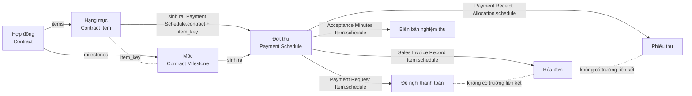
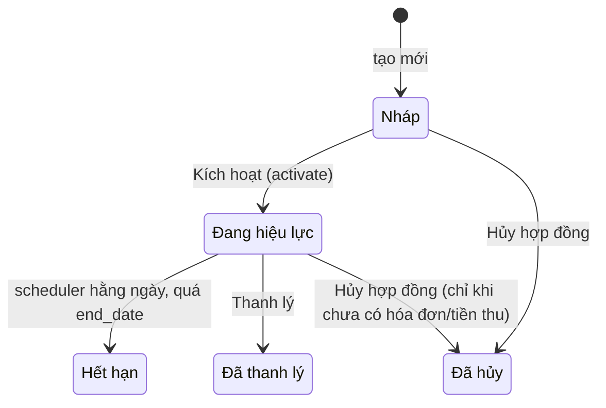
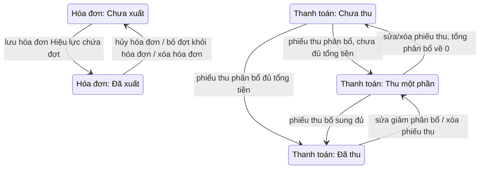
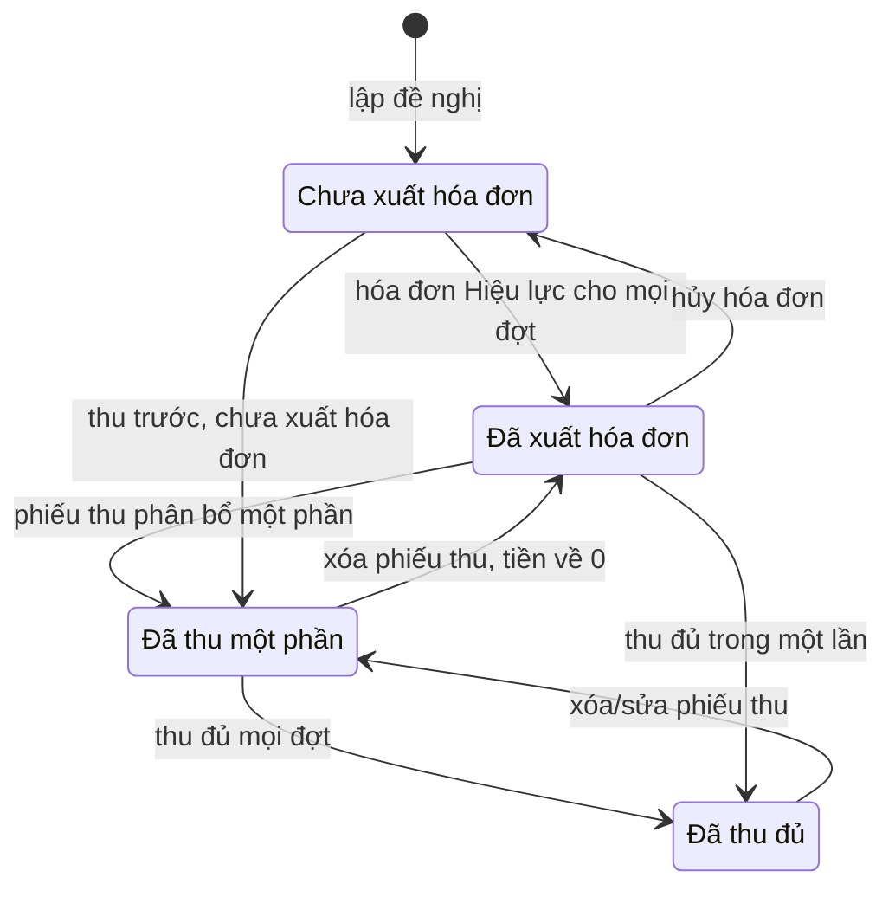
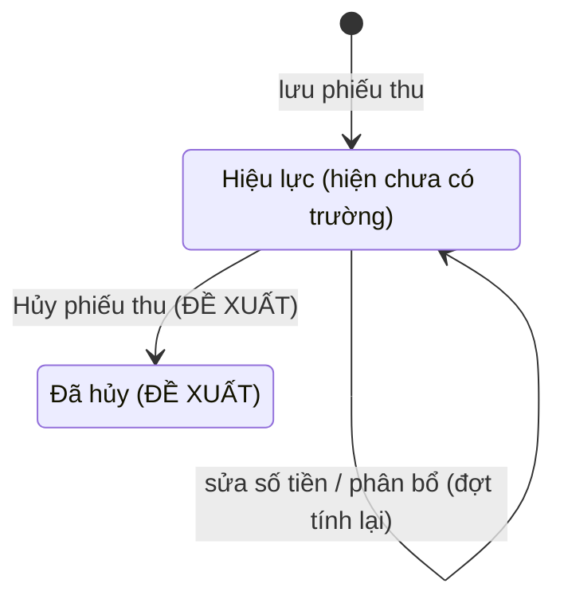

# Vòng đời chứng từ thu tiền và nguồn số liệu

Tài liệu này **bổ sung cho `lha-quan-ly-hop-dong.md`** (gọi tắt "tài liệu gốc"). Tài liệu gốc mô tả cần làm gì; tài liệu này
ghi **code đang làm gì** về vòng đời chứng từ và nguồn số liệu, để các màn không còn lệch số và đi tiếp được giữa các chứng từ.

- Chỉ là tài liệu: không đổi code, không đổi DocType. Mọi chỗ "đề xuất" / "cần bổ sung" là việc của ticket code sau.
- Mọi khẳng định về code kèm nguồn `tệp:dòng`. Quy ước viết tắt đường dẫn:

| Viết tắt | Đường dẫn đầy đủ |
|---|---|
| `contract.py` | `contract_tracker/contract_tracker/doctype/contract/contract.py` |
| `payment_schedule.py` | `contract_tracker/contract_tracker/doctype/payment_schedule/payment_schedule.py` |
| `payment_request.py` | `contract_tracker/contract_tracker/doctype/payment_request/payment_request.py` |
| `sales_invoice_record.py` | `contract_tracker/contract_tracker/doctype/sales_invoice_record/sales_invoice_record.py` |
| `payment_receipt.py` | `contract_tracker/contract_tracker/doctype/payment_receipt/payment_receipt.py` |
| `acceptance_minutes.py` | `contract_tracker/contract_tracker/doctype/acceptance_minutes/acceptance_minutes.py` |
| `api.py`, `tasks.py` | `contract_tracker/api.py`, `contract_tracker/tasks.py` |
| `paymentSchedule.ts`, `contract.ts` | `frontend/src/pages/payment-schedules/paymentSchedule.ts`, `frontend/src/pages/contracts/contract.ts` |

- Số tiền VND nguyên đồng, viết 1.234.567. Thuế làm tròn bằng `round_vnd` (0,5 làm tròn lên, `contract.py:51`).
- Trạng thái ghi theo đúng chữ trong DocType (ví dụ `Thu một phần`, `Đã thu`).

---

## 1. Bản đồ chứng từ

Đường nét đứt: **không có** trường liên kết lưu trong CSDL; chỉ suy ra được qua các đợt thu chung.

### 1.1 Quan hệ giữa các chứng từ

"Thiết kế dữ liệu" là cái cấu trúc bảng cho phép; "Luật code" là cái kiểm tra ở controller đang ép. Hai cột khác nhau ở chỗ nào thì chỗ đó là điểm cần chú ý.

| Cặp | Quan hệ (thiết kế dữ liệu → luật code) | Trường liên kết (theo JSON DocType) | Ghi chú / nguồn |
|---|---|---|---|
| Hợp đồng → Hạng mục | 1-n | `Contract.items` (Table → Contract Item); dòng định danh bằng `item_key` (Data, tự sinh `contract.py:175-176`) | Hạng mục có `billing_type` Một lần / Nhiều đợt / Định kỳ |
| Hợp đồng → Mốc | 1-n | `Contract.milestones` (Table → Contract Milestone) | Bảng con **riêng**, không nằm trong Hạng mục |
| Hạng mục ↔ Mốc | 1-n | `Contract Milestone.item_key` (Data) = `Contract Item.item_key`; **không phải Link** | Chỉ hạng mục `Nhiều đợt` có mốc; mốc mồ côi bị xóa khi lưu (`contract.py:259-263`) |
| Hợp đồng → Đợt thu | 1-n | `Payment Schedule.contract` (Link → Contract) | Đợt do hệ thống sinh khi Kích hoạt (`contract.py:300-309`) |
| Hạng mục/mốc → Đợt thu | 1-n: Một lần = 1 đợt; Nhiều đợt = số mốc; Định kỳ = số kỳ | `Payment Schedule.item_key` (Data) + khóa phụ: tên mốc hoặc ngày bắt đầu kỳ (`payment_schedule.py:189-190`, `326-336`) | **Không có Link tới dòng hạng mục/mốc**; đợt sao chép `item_name`, `vat_rate`, `requires_acceptance` |
| Đợt thu ↔ Đề nghị | Thiết kế: n-n. **Luật code: 1-n** (mỗi đợt nằm trong tối đa 1 đề nghị, Nháp hoặc Đã gửi) | `Payment Request Item.schedule` (Link → Payment Schedule) + `Payment Request Item.contract` (Link → Contract) | `payment_request.py:93,105-106` (báo "đã nằm trong đề nghị …"). Trên đợt chỉ có `request_status` (Chưa lập / Đã lập), không lưu mã đề nghị |
| Đợt thu ↔ Hóa đơn | Thiết kế: n-n. **Luật code: 1-n** (mỗi đợt chỉ thuộc 1 hóa đơn Hiệu lực; hóa đơn Đã hủy không tính) | `Sales Invoice Record Item.schedule` (Link → Payment Schedule) + `Sales Invoice Record Item.contract` | `sales_invoice_record.py:77,92-93`, `payment_schedule.py:46-64`. Trên đợt có `invoice_status` và `invoice_no` (Data, **số hóa đơn nhập tay**, không phải mã bản ghi) |
| Đợt thu ↔ Phiếu thu | **n-n thật**: một phiếu phân bổ nhiều đợt; một đợt nhận tiền từ nhiều phiếu (trong một phiếu, một đợt chỉ một dòng) | `Payment Receipt Allocation.schedule` (Link → Payment Schedule) + `contract` + `allocated_amount` | `payment_receipt.py:43-45`. Trên đợt có `paid_amount`, `payment_status` |
| Đợt thu ↔ Biên bản | Thiết kế: n-n. **Luật code: 1-n** (mỗi đợt tối đa 1 biên bản, Nháp hoặc Đã ký) | `Acceptance Minutes Item.schedule` (Link → Payment Schedule) + `contract` | `acceptance_minutes.py:114,127-128`. Trên đợt có `acceptance_status` |
| Đề nghị → Hóa đơn | **Không có trường liên kết**; quan hệ suy ra qua đợt chung: n-n | không có | `get_request_schedules_for_invoice` (`api.py:158-184`) chỉ để điền sẵn các đợt vào form hóa đơn, không lưu mã đề nghị |
| Hóa đơn → Phiếu thu | **Không có trường liên kết**; suy ra qua đợt chung: n-n | không có | `suggest_allocation(invoice=…)` (`api.py:213-237`) chỉ dùng để sắp xếp ưu tiên, không lưu |
| Hóa đơn → Dòng thuế | 1-n | `Sales Invoice Record.tax_breakdown` (Table → Sales Invoice Tax Row) | Gộp theo `vat_rate`, tự tính khi lưu (`sales_invoice_record.py:107-123`) |
| Mọi chứng từ → Khách hàng | n-1 | `customer` (Link → Contract Customer) trên Hợp đồng, Đợt thu, Đề nghị, Hóa đơn, Phiếu thu, Biên bản | Quy tắc §5.6: mỗi chứng từ chỉ gồm đợt cùng khách hàng; kiểm ở từng controller |
| Chứng từ → Hợp đồng | n-1, nhiều hợp đồng trong một chứng từ | `contract` trên **dòng con** (không có trên đầu chứng từ) | Một đề nghị/hóa đơn/phiếu thu/biên bản có thể gồm đợt của nhiều hợp đồng cùng khách hàng |

### 1.2 Code khác tài liệu

| # | Mục tài liệu gốc | Thực tế trong code | Hệ quả |
|---|---|---|---|
| 1 | §3.5 Đề nghị: "Trạng thái Nháp / Đã gửi" | Khớp: `status` chỉ có `Nháp`, `Đã gửi` (`payment_request.json`, `payment_request.py:30-31`). Không có trạng thái theo hóa đơn / thu tiền; **không có hủy đề nghị** | Không biết đề nghị đã xuất hóa đơn / đã thu chưa nếu không mở từng đợt. Đề nghị `Đã gửi` không xóa, không hủy, không gỡ được (`payment_request.py:135-137`): các đợt trong đó **bị khóa "Đã lập" vĩnh viễn**. Xem §2.3 |
| 2 | §3.6 Hóa đơn: "Hủy được khi chưa có tiền thu … hủy thì các đợt trở lại Chưa xuất" | Khớp phần hủy: `cancel_invoice` chặn khi có tiền phân bổ (`sales_invoice_record.py:146-148`); sau hủy `refresh_schedules` đưa đợt về `Chưa xuất` (`payment_schedule.py:152-182`). **Tài liệu không nói về xóa; code cho xóa hóa đơn `Đã hủy`** (`sales_invoice_record.py:134-136`). Hóa đơn `Hiệu lực` vẫn **sửa được** (đổi/bớt đợt) kể cả khi đã có tiền thu vào đợt (`guard_status` chỉ khóa `Đã hủy`, dòng 61-68) | Mất dấu vết hóa đơn đã hủy (trái B5); sửa hóa đơn đã thu làm lệch trạng thái đợt. Cần bổ sung: chặn xóa hóa đơn `Đã hủy`; khóa sửa hóa đơn đã có tiền thu |
| 3 | §3.7 Phiếu thu: không nói hủy / xóa | Phiếu thu **không có trường trạng thái, không có hàm hủy**; chỉ `on_trash` tính lại đợt rồi cho xóa (`payment_receipt.py:84-86`); giao diện có nút "Xóa phiếu thu" (`ReceiptList.vue:111-127`) | Xóa cứng chứng từ tiền đã phát sinh: trái B5. Số "Đã thu" của đợt/hợp đồng tụt ngay mà không còn bút toán nào để đối chiếu. Cần bổ sung trạng thái `Đã hủy` thay cho xóa. Xem §2.5 |
| 4 | Chuẩn chất lượng A1/A2 (submit/hủy, track_changes) | **Không DocType nào `is_submittable`**; các chứng từ tự quản trạng thái bằng trường `status`. `track_changes = 1` cho Hợp đồng, Đề nghị, Hóa đơn, Phiếu thu, Biên bản; **Payment Schedule `track_changes = 0`** | Hủy ghi người/thời điểm qua Version của Frappe (có ở 5 chứng từ), nhưng đợt thu (nơi lưu số liệu) không có lịch sử thay đổi |
| 5 | §3.2 "Hạng mục (bảng con trong hợp đồng)", mốc nằm trong hạng mục | **Hai bảng con riêng** `items` và `milestones` trong Hợp đồng, nối bằng `item_key` (Data) | Không có ràng buộc CSDL giữa dòng mốc và dòng hạng mục; xóa/đổi `item_key` làm mốc mồ côi (code tự dọn khi lưu). Giao diện phải gộp hai bảng khi hiển thị |
| 6 | §3.6 "chọn từ một đề nghị để lấy sẵn các đợt" | Chỉ điền sẵn, **không lưu liên kết Hóa đơn → Đề nghị** (xem §1.1) | Không trả lời được "đề nghị này đã xuất hóa đơn nào", "hóa đơn này từ đề nghị nào" ngoài việc đối chiếu các đợt chung |
| 7 | §3.3 Trạng thái đợt: 5 nhóm Nghiệm thu · Đề nghị · Hóa đơn · Thanh toán · Quá hạn | Khớp 5 nhóm, nhưng lưu thành **4 trường Select + 1 Check**: `acceptance_status` (Không cần/Chưa/Đã ký), `request_status` (Chưa lập/Đã lập), `invoice_status` (Chưa xuất/Đã xuất) + `invoice_no`, `payment_status` (Chưa thu/Thu một phần/Đã thu) + `paid_amount`, `is_overdue` (Check). **Không có một trạng thái tổng** của đợt | `is_overdue` là cờ **lưu**, cập nhật khi chứng từ đổi (`payment_schedule.py:148,179`) và 1 lần/ngày (`tasks.py:37-49`, hooks `scheduler_events` daily) nên có thể chậm tối đa tới lần chạy kế tiếp. "Đã lập" nghĩa là nằm trong đề nghị Nháp **hoặc** Đã gửi; "Đã ký" chỉ khi biên bản `Đã ký` (biên bản Nháp vẫn là "Chưa") (`payment_schedule.py:169,178`) |
| 8 | §5.3 "Không xóa hợp đồng đã có đợt gắn chứng từ; **chỉ chuyển Đã hủy**" | `cancel_contract` **chặn** hủy hợp đồng có đợt gắn chứng từ: "Hợp đồng đã có đợt thu gắn chứng từ, không hủy được." (`contract.py:357-358`). `on_trash` chỉ cho xóa hợp đồng Nháp chưa có chứng từ (`contract.py:316-318`) | Hợp đồng đã có chứng từ **không có đường nào để dừng**, ngoài Thanh lý. Trái chữ §5.3. Chờ anh Linh quyết (câu 4, §6) |
| 9 | §5.2 "đợt chưa có chứng từ nào (nghiệm thu, đề nghị, hóa đơn, thu tiền) thì sinh lại; đã có chứng từ thì giữ" | "Có chứng từ" trong code (`has_documents`, `payment_schedule.py:35-43`) chỉ là **hóa đơn Hiệu lực hoặc tiền thu > 0**. Đợt chỉ có đề nghị hoặc biên bản bị coi là "chưa có" nên bị **xóa và sinh lại với mã mới**, xóa bằng `force=True` (`payment_schedule.py:307,317`) | Dòng đề nghị/biên bản trỏ vào đợt đã bị xóa có thể thành liên kết treo (đọc code, chưa chạy thử). Cần bổ sung: `has_documents` tính cả `request_status = Đã lập` và biên bản |
| 10 | §3.1 "Số tổng (tự tính): giá trị trước thuế, tiền thuế, tổng sau thuế, đã xuất HĐ, đã thu, còn phải thu" | Ba số đầu tính từ **hạng mục**; ba số sau tính từ **đợt thu**; `outstanding_amount` = tổng từ hạng mục − đã thu từ đợt (`contract.py:267-296`, `369-386`) | Hai nguồn trộn trong một công thức: hợp đồng lệch tổng các đợt khi sửa hạng mục lúc đã có đợt giữ nguyên. Xem §3.2 và kịch bản C |
| 11 | §3.4 "file scan biên bản đã ký" (không nói bắt buộc) | Bắt buộc có file scan mới Đánh dấu đã ký, và sau khi ký không được xóa scan (`acceptance_minutes.py:96-97,171-172`) | Quyết ở câu 3, §6 |
| 12 | §5.5 "Hết hạn: vẫn theo dõi các đợt còn nợ" | Đúng: Hết hạn vẫn lập được hóa đơn / thu tiền (`BILLABLE_CONTRACT_STATUSES`, `payment_schedule.py:23`). Nhưng hợp đồng `Hết hạn` bị **khóa sửa** (`contract.py:157-158`) và **không thanh lý được** (`liquidate` chỉ từ Đang hiệu lực, `contract.py:365`); scheduler chỉ chuyển khi có `end_date` (`tasks.py:22-34`) | Không có đường gia hạn/sửa; xem câu 5, §6 |
| 13 | §3.7 "phần dư ghi chưa phân bổ" | Đúng: `unallocated_amount` = `amount` − `allocated_total` (`payment_receipt.py:72-73`) | Không có |

---

## 2. Sơ đồ trạng thái

Quy ước cột: **Sửa được?** = sửa nội dung chứng từ; **Hủy được?** = chuyển sang trạng thái hủy; **Xóa được?** = xóa bản ghi. Quy tắc chung (bám §5.3 tài liệu gốc và B5 chuẩn chất lượng): **không xóa cứng dữ liệu đã phát sinh giao dịch**; muốn dừng thì dùng trạng thái. Chỗ code đang cho xóa cứng thì đánh dấu **cần bổ sung**.

### 2.1 Hợp đồng (`Contract.status`)

| Trạng thái | Điều kiện vào | Sự kiện chuyển | Sửa được? | Hủy được? | Xóa được? |
|---|---|---|---|---|---|
| Nháp | Tạo mới (`before_insert` đặt `Nháp`, `contract.py:139`). Chưa có đợt thu | Kích hoạt (cần ≥ 1 hạng mục, `contract.py:348-349`) → Đang hiệu lực. Hủy hợp đồng → Đã hủy | Có, tự do | Có | Có (`on_trash`: chỉ Nháp và chưa có đợt gắn chứng từ, `contract.py:316-318`) |
| Đang hiệu lực | Kích hoạt từ Nháp; đợt thu được sinh trong cùng giao dịch (`contract.py:304-305`) | Hết hạn (scheduler, `end_date` đã đặt và < hôm nay, `tasks.py:22-34`); Thanh lý; Hủy | Có. Lưu lại thì đợt chưa có hóa đơn/tiền thu bị sinh lại, đợt đã có giữ nguyên (`payment_schedule.py:310-323`) | Có, **chỉ khi không đợt nào có hóa đơn Hiệu lực hoặc tiền thu** (`contract.py:357-358`) | Không ("Chỉ xóa được hợp đồng ở trạng thái Nháp") |
| Hết hạn | Scheduler hằng ngày, không chạm vào đợt thu | Không có chuyển tiếp nào trong code (không thanh lý, không gia hạn) | Không (`LOCKED_STATUSES`, `contract.py:43,157-158`). Vẫn ghi được hóa đơn / thu tiền | Không | Không |
| Đã thanh lý | Thanh lý từ Đang hiệu lực | Cuối vòng đời | Không. Vẫn ghi được hóa đơn / thu tiền | Không | Không |
| Đã hủy | Hủy từ Nháp hoặc Đang hiệu lực (nếu chưa có chứng từ, `contract.py:353-359`). Đợt chưa chứng từ bị xóa (`contract.py:306-309`) | Cuối vòng đời | Không | — | Không. Không lập hóa đơn / thu tiền được (không thuộc `BILLABLE_CONTRACT_STATUSES`) |

Cần bổ sung (chờ câu 4, 5 ở §6): đường hủy cho hợp đồng đã có chứng từ; gia hạn cho hợp đồng Hết hạn.

### 2.2 Đợt thu (`Payment Schedule`)

Đợt thu **không có một trạng thái tổng**; có 4 trục trạng thái + cờ Quá hạn, tất cả do hệ thống tự tính và **lưu** lại từ chứng từ (`refresh_schedules`, `payment_schedule.py:152-182`). Người dùng không sửa đợt (`payment_schedule.py:28`).

Bảng trạng thái. Cột "Sửa được?" luôn là **Không (tự tính)** và "Hủy được?" luôn **Không áp dụng**; cột "Xóa được?" là việc **hệ thống** xóa khi sinh lại đợt / hủy hợp đồng, quyết bởi `has_documents` (hóa đơn Hiệu lực hoặc `paid_amount` > 0, `payment_schedule.py:43`):

| Trục · Trạng thái | Điều kiện vào | Sự kiện chuyển | Sửa / Hủy | Xóa được? |
|---|---|---|---|---|
| Nghiệm thu · Không cần | `requires_acceptance = 0` | Đổi hạng mục/mốc rồi sinh lại | Không / — | Có (nếu chưa hóa đơn, chưa thu) |
| Nghiệm thu · Chưa | `requires_acceptance = 1`, chưa có biên bản **Đã ký** | Biên bản → Đã ký | Không / — | Có, **kể cả khi đã nằm trong biên bản Nháp hoặc đã ký** (chỉ xét hóa đơn, tiền thu) |
| Nghiệm thu · Đã ký | Có biên bản `Đã ký` chứa đợt (`payment_schedule.py:169,178`) | Biên bản Đã ký không xóa được → trạng thái này không tự mất | Không / — | Có nếu chưa hóa đơn, chưa thu (xem lệch #9) |
| Đề nghị · Chưa lập | Đợt không nằm trong đề nghị nào | Lưu đề nghị chứa đợt | Không / — | Có |
| Đề nghị · Đã lập | Đợt nằm trong đề nghị Nháp hoặc Đã gửi (`payment_schedule.py:67-84`) | Xóa đề nghị Nháp → Chưa lập. Đề nghị Đã gửi: không có đường quay lại | Không / — | Có nếu chưa hóa đơn, chưa thu (xem lệch #9) |
| Hóa đơn · Chưa xuất | Không có hóa đơn Hiệu lực chứa đợt | Lưu hóa đơn Hiệu lực chứa đợt → Đã xuất | Không / — | Có nếu chưa thu |
| Hóa đơn · Đã xuất | Có hóa đơn Hiệu lực; `invoice_no` lấy từ hóa đơn (`payment_schedule.py:144-145`) | Hủy / xóa hóa đơn, hoặc bỏ đợt khỏi hóa đơn → Chưa xuất (chỉ khi chưa có tiền thu, trừ trường hợp sửa hóa đơn, xem lệch #2) | Không / — | **Không** |
| Thanh toán · Chưa thu | `paid_amount ≤ 0` | Phiếu thu phân bổ vào đợt | Không / — | Có nếu chưa hóa đơn |
| Thanh toán · Thu một phần | `0 < paid_amount < total_amount` (sai số `TOLERANCE` = 0,01, `contract.py:48`) | Phiếu thu bổ sung → Đã thu; xóa phiếu → Chưa thu | Không / — | **Không** |
| Thanh toán · Đã thu | `total_amount − paid_amount ≤ 0,01` | Xóa/sửa phiếu thu → Thu một phần / Chưa thu | Không / — | **Không** |
| Quá hạn (`is_overdue` = 1) | `due_date` < hôm nay **và** còn nợ > 0,01 (`payment_schedule.py:148`) | Thu đủ, hoặc cập nhật hằng ngày (`tasks.py:37-49`) | Không / — | Theo `has_documents` |

Hệ quả cho cột "Xóa được?": đợt bị coi "có chứng từ" **chỉ** vì hóa đơn Hiệu lực hoặc tiền thu, không vì đề nghị hay biên bản (lệch #9, §1.2).

### 2.3 Đề nghị thanh toán (`Payment Request`)

Có **hai lớp** trạng thái, độc lập nhau:

- **Lớp (a) — trạng thái LƯU, đã có trong code:** `Nháp` / `Đã gửi` (`status`). Là trạng thái **gửi cho khách**.
- **Lớp (b) — trạng thái TIẾN ĐỘ, **đề xuất, chưa có trong code**:** `Chưa xuất hóa đơn`, `Đã xuất hóa đơn`, `Đã thu một phần`, `Đã thu đủ`. **Tính khi đọc, không lưu** (một nguồn: các đợt trong `items`, đúng nguyên tắc §3), từ `invoice_status` và `payment_status` (hoặc `paid_amount`) của từng đợt.

Hai lớp kết hợp: Nháp/Đã gửi cho biết đề nghị đã đến tay khách chưa; lớp (b) cho biết tiền đến đâu. Ví dụ "Đã gửi · Đã thu một phần". Quy tắc khóa sửa/xóa vẫn theo lớp (a). Lớp (b) không chặn thao tác nào.

**Quy tắc tính lớp (b)** (kiểm theo thứ tự, đề xuất): 

1. **Đã thu đủ**: mọi đợt trong đề nghị có `payment_status = Đã thu`.
2. **Đã thu một phần**: có ít nhất một đợt có `paid_amount > 0` (nhưng chưa thỏa 1).
3. **Đã xuất hóa đơn**: mọi đợt có `invoice_status = Đã xuất` (và chưa có tiền thu).
4. **Chưa xuất hóa đơn**: còn lại (gồm trường hợp mới xuất hóa đơn cho một số đợt; nên hiện kèm "x/y đợt đã xuất").

Thu tiền trước khi xuất hóa đơn (§3.7) vẫn rơi vào mục 1 hoặc 2: tiền có trước hóa đơn. Cột hóa đơn ở danh sách vẫn thể hiện riêng.

**Lớp (a) — trạng thái lưu hiện có:**

| Trạng thái | Điều kiện vào | Sự kiện chuyển | Sửa được? | Hủy được? | Xóa được? |
|---|---|---|---|---|---|
| Nháp | Tạo mới (`payment_request.py:56-57`) | Đánh dấu đã gửi (`mark_sent`, một chiều, `payment_request.py:143-159`) | Có, mọi trường. Dòng đợt chỉ nhận đợt cùng khách, còn nợ, hợp đồng Đang hiệu lực/Hết hạn/Đã thanh lý, chưa nằm trong đề nghị khác (`payment_request.py:84-118`) | Không có chức năng hủy. **Cần bổ sung** nếu muốn thu hồi | Có (`on_trash`, `payment_request.py:135-139`); đợt về "Chưa lập". Chấp nhận được vì chưa gửi, chưa phát sinh giao dịch |
| Đã gửi | `mark_sent` từ Nháp | Cuối vòng đời trong code | Chỉ sửa ghi chú; khóa khách, ngày, hạn, tài khoản, danh sách đợt (`payment_request.py:43,71-76`) | **Không có.** Đề xuất: thêm `Đã hủy` để giải phóng các đợt, thay cho xóa | Không ("Chỉ xóa được đề nghị Nháp") |

**Lớp (b) — trạng thái tiến độ (đề xuất, cần bổ sung):**

| Trạng thái | Điều kiện vào | Sự kiện chuyển | Sửa được? | Hủy được? | Xóa được? |
|---|---|---|---|---|---|
| Chưa xuất hóa đơn | Mới lập, hoặc chưa đủ đợt có hóa đơn Hiệu lực | Hóa đơn Hiệu lực cho đủ đợt → Đã xuất hóa đơn; thu tiền → Đã thu một phần / Đã thu đủ | Không sửa trực tiếp (tự tính); thao tác sửa theo lớp (a) | Theo lớp (a) | Theo lớp (a) |
| Đã xuất hóa đơn | Mọi đợt có hóa đơn Hiệu lực, chưa có tiền thu | Hủy hóa đơn → Chưa xuất hóa đơn; thu tiền → Đã thu một phần / Đã thu đủ | Như trên | Như trên | Như trên |
| Đã thu một phần | Ít nhất một đợt có tiền thu, chưa đủ mọi đợt | Thu thêm → Đã thu đủ; xóa/hủy phiếu thu → trạng thái trước | Như trên | Như trên | Như trên |
| Đã thu đủ | Mọi đợt `Đã thu` | Xóa/hủy phiếu thu → Đã thu một phần | Như trên | Như trên | Như trên |

Giá trị hiển thị `Payment Request Item.outstanding` **không** phải nguồn của lớp (b); xem §3.3.

### 2.4 Hóa đơn (`Sales Invoice Record`)

```mermaid
stateDiagram-v2
    [*] --> HiệuLực: lưu hóa đơn
    HiệuLực --> ĐãHủy: Hủy hóa đơn (chưa có tiền thu)
    ĐãHủy --> [*]: xóa (hiện code cho phép; cần bổ sung chặn)
    state "Hiệu lực" as HiệuLực
    state "Đã hủy" as ĐãHủy
```

| Trạng thái | Điều kiện vào | Sự kiện chuyển | Sửa được? | Hủy được? | Xóa được? |
|---|---|---|---|---|---|
| Hiệu lực | Tạo mới (`before_insert`, `sales_invoice_record.py:47-48`). Đợt cùng khách, chưa thuộc hóa đơn Hiệu lực khác, hợp đồng Đang hiệu lực/Hết hạn/Đã thanh lý; trùng (số, ký hiệu) bị chặn (`:98-105`) | Hủy hóa đơn (`cancel_invoice`) → Đã hủy | **Có** (kể cả khi đợt đã nhận tiền; cần bổ sung khóa khi đã có tiền thu, xem lệch #2). Dòng tiền/thuế luôn lấy lại từ đợt | **Có, khi không đợt nào của hóa đơn có tiền phân bổ** (`:146-148`); đợt về Chưa xuất | Không ("Chỉ xóa được hóa đơn Đã hủy", `:134-136`) |
| Đã hủy | `cancel_invoice`; đợt về `Chưa xuất`, `invoice_no` trống | Cuối vòng đời | Không (`:61-66`) | — | **Hiện code cho xóa** (`on_trash`). Trái B5/§5.3: **cần bổ sung** chặn xóa, giữ làm dấu vết; giao diện Vue hiện không có nút xóa hóa đơn |

### 2.5 Phiếu thu (`Payment Receipt`)

Hiện trạng: **không có trường trạng thái**. Phiếu thu tồn tại → tiền tính vào đợt. Số tiền > 0, phân bổ tối đa bằng số còn nợ và tổng phân bổ ≤ số tiền (`payment_receipt.py:29-75`); phiếu được lưu được khi không phân bổ dòng nào (thu trước, phần dư "chưa phân bổ").

Đề xuất cho ticket sau: thêm `status` = `Hiệu lực` / `Đã hủy`, thay thế xóa.

| Trạng thái | Điều kiện vào | Sự kiện chuyển | Sửa được? | Hủy được? | Xóa được? |
|---|---|---|---|---|---|
| Hiệu lực (hiện: mọi phiếu thu đang tồn tại) | Lưu phiếu với `amount > 0`, đợt cùng khách, hợp đồng Đang hiệu lực/Hết hạn/Đã thanh lý, phân bổ ≤ còn nợ | Sửa phân bổ → `refresh_schedules` tính lại (`payment_receipt.py:77-82`) | **Có, không giới hạn** (không khóa theo ngày, không theo hóa đơn) | **Chưa có.** Đề xuất: Hủy → Đã hủy, tiền rút khỏi đợt | **Hiện: có, xóa cứng** (`payment_receipt.py:84-86`, nút "Xóa phiếu thu"). **Cần bổ sung:** chặn xóa, thay bằng Hủy (B5) |
| Đã hủy (đề xuất, cần bổ sung) | Hủy từ Hiệu lực | Cuối vòng đời | Không | — | Không |

---

## 3. Bảng nguồn số liệu

### 3.1 Nguyên tắc

1. **Mỗi con số chỉ có MỘT nguồn.** Chỗ khác chỉ đọc lại hoặc cộng lại từ nguồn đó, không tính theo đường khác.
2. **Đề xuất đợt thu là nguồn, hợp đồng cộng từ các đợt.** Số tiền của một hợp đồng đang hiệu lực = tổng các đợt của nó. Hạng mục là **kế hoạch** dùng để sinh đợt; sau khi kích hoạt, số tổng không đọc lại từ hạng mục. Hợp đồng Nháp (chưa có đợt) hiện số xem trước bằng đúng hàm sinh đợt `build_schedules` để hai đường không bao giờ khác nhau.
3. Số **lưu cố định** chỉ để lọc / sắp xếp / hiển thị nhanh và phải được cập nhật cùng giao dịch với chứng từ; nó là bản sao của nguồn, không phải nguồn.

### 3.2 Bảng nguồn (theo code hiện tại)

"Lưu / tính" = số **được lưu** thành cột trong CSDL, hay **tính lại khi đọc**.

| Tên số | Màn hiển thị | Nguồn (bảng.trường) | Lưu cố định hay tính lại | Công thức |
|---|---|---|---|---|
| Hợp đồng · `total_before_tax` | Form hợp đồng (mục tổng); thẻ aside danh sách | `Contract Item`: `amount` (Một lần), `item_value` (Nhiều đợt), `recurring_amount(...)` (Định kỳ) → `Contract Item.amount_before_tax` | **Lưu**, tính lại mỗi lần lưu hợp đồng (`contract.py:267-290`) | Σ `Contract Item.amount_before_tax`. **Nguồn là hạng mục, không phải đợt** |
| Hợp đồng · `total_tax` | Form hợp đồng; aside danh sách ("Tiền thuế") | `Contract Item.tax_amount` (mỗi hạng mục: `round_vnd(trước thuế × thuế suất / 100)`, 0 nếu Không chịu thuế) | **Lưu**, như trên | Σ `Contract Item.tax_amount`. Làm tròn theo **hạng mục**, trong khi đợt làm tròn theo **từng đợt** (`payment_schedule.py:274`) |
| Hợp đồng · `total_after_tax` | Form; danh sách (thẻ "Tổng giá trị sau thuế"); aside | `Contract.total_before_tax + total_tax` | **Lưu**, như trên | `total_before_tax + total_tax` |
| Hợp đồng · `invoiced_amount` (đã xuất HĐ) | Form hợp đồng | `Payment Schedule.total_amount` với `invoice_status = Đã xuất` | **Lưu** trên Contract; `refresh_contract_amounts` cập nhật khi hóa đơn/phiếu đổi (`payment_schedule.py:181-182`) và kiểm lại hằng ngày (`tasks.py:51-59`) | Σ `Payment Schedule.total_amount` của đợt `Đã xuất` (`contract.py:380`) |
| Hợp đồng · `paid_amount` (đã thu) | Form; danh sách (thẻ "Đã thu", cột); aside | `Payment Schedule.paid_amount` ← Σ `Payment Receipt Allocation.allocated_amount` | **Lưu**, như trên | Σ `Payment Schedule.paid_amount` của hợp đồng (`contract.py:381`) |
| Hợp đồng · `outstanding_amount` (còn phải thu) | Form; danh sách (thẻ, dòng Tổng); aside | `Contract.total_after_tax` (**từ hạng mục**) và `Payment Schedule.paid_amount` (**từ đợt**) | **Lưu**, như trên | `total_after_tax − Σ paid_amount` (`contract.py:385`). **Hai nguồn trong một công thức** (xem §3.4, mục V1) |
| Đợt thu · `amount_before_tax`, `tax_amount`, `total_amount` | Lịch thu, tab Lịch thu của hợp đồng | Sinh từ hạng mục/mốc/kỳ bởi `build_schedules` (`payment_schedule.py:224-290`) | **Lưu** lúc sinh; không đổi sau đó (đợt đã chứng từ giữ nguyên) | `total = trước thuế + thuế`; thuế = `round_vnd(trước thuế × rate / 100)` mỗi đợt. **Đây là nguồn gốc của mọi số tiền** |
| Đợt thu · `paid_amount` | Lịch thu | Σ `Payment Receipt Allocation.allocated_amount` theo `schedule` (`paid_by_schedule`, `payment_schedule.py:109-124`) | **Lưu** (bản sao), tính lại trong `refresh_schedules` mỗi khi hóa đơn/phiếu/đề nghị/biên bản đổi | Σ phân bổ của mọi phiếu thu |
| Đợt thu · còn nợ (hiển thị) | Lịch thu (cột "Còn nợ", thẻ); form phiếu thu | `total_amount`, `paid_amount` | **Tính lại khi đọc** (không có cột lưu): giao diện `outstandingOf` (`paymentSchedule.ts:64-66`); API `outstanding_of`, `get_requestable_schedules`, `get_receivable_schedules` | `total_amount − paid_amount` (API: `total_amount − Σ phân bổ`, cùng kết quả) |
| Đợt thu · `payment_status`, `invoice_status`, `request_status`, `acceptance_status` | Lịch thu, tab Lịch thu | Phiếu thu / hóa đơn Hiệu lực / đề nghị / biên bản Đã ký | **Lưu** (bản sao) bởi `refresh_schedules` | Xem §2.2 |
| Đợt thu · `is_overdue` | Lịch thu, thẻ "Quá hạn" | `due_date`, `total_amount`, `paid_amount`, ngày hiện tại | **Lưu**; tính lại khi chứng từ đổi và mỗi ngày (`tasks.py:37-49`) | `due_date < hôm nay` và `total − paid > 0,01` |
| Đề nghị · dòng `outstanding` | Form đề nghị (cột "Còn nợ") | `Payment Schedule.total_amount − Σ phân bổ` **tại thời điểm lưu đề nghị** (`payment_request.py:107,118`) | **Lưu**, chỉ cập nhật khi lưu lại đề nghị | `total_amount − paid` lúc lưu. **Cũ đi khi thu thêm** (xem V2) |
| Đề nghị · `grand_total`, `total_before_tax`, `total_tax` | Form, danh sách đề nghị | `Payment Request Item.*` (sao chép từ đợt lúc lưu, `payment_request.py:115-117`) | **Lưu**, tính lại mỗi lần lưu (`:120-124`) | Σ dòng |
| Hóa đơn · `grand_total`, `total_before_tax`, `total_tax`, `tax_breakdown` | Form, danh sách hóa đơn | `Sales Invoice Record Item.*` (sao chép từ đợt lúc lưu) | **Lưu**, tính lại mỗi lần lưu (`sales_invoice_record.py:107-123`) | Σ dòng; `tax_breakdown` gộp theo `vat_rate` |
| Phiếu thu · dòng phân bổ `outstanding_amount` | Form phiếu thu (cột "Còn nợ") | `Payment Schedule.total_amount − Σ phân bổ của các phiếu khác` **lúc lưu phiếu** (`outstanding_of(..., exclude_receipt=self.name)`, `payment_receipt.py:59,70`) | **Lưu** | Còn nợ của đợt **trước** phân bổ của phiếu này. Là ảnh chụp tại lúc lưu, không phải số còn nợ hiện tại (xem V2) |
| Phiếu thu · `allocated_total` | Danh sách / form phiếu thu | Σ `Payment Receipt Allocation.allocated_amount` | **Lưu** lúc lưu phiếu (`payment_receipt.py:72`) | Σ `allocated_amount` |
| Phiếu thu · `unallocated_amount` ("Chưa phân bổ") | Danh sách / form phiếu thu; thẻ danh sách phiếu | `Payment Receipt.amount`, `allocated_total` | **Lưu** lúc lưu phiếu (`:73`); form tính lại ngay khi nhập (`receipts.ts:230-232`) | `amount − allocated_total` |
| Lịch thu · thẻ "Phải thu trong kỳ" | Lịch thu | Các đợt trong bộ lọc, có `due_date` trong kỳ (mặc định tháng hiện tại) | **Tính lại ở trình duyệt** (`statCards`, `paymentSchedule.ts:252-257`) | Σ `(total_amount − paid_amount)` của đợt có `due_date` trong kỳ |
| Lịch thu · thẻ "Đã thu" | Lịch thu | Như trên | Tính ở trình duyệt (`:258`) | Σ `paid_amount` của đợt có **`due_date`** trong kỳ (không phải ngày thu tiền) |
| Lịch thu · thẻ "Quá hạn" | Lịch thu | `is_overdue` (cờ lưu) | Tính ở trình duyệt (`:254,259-264`) | Σ `(total − paid)` của đợt `is_overdue = 1`, không giới hạn kỳ; kèm số đợt |
| Lịch thu · thẻ "Chưa xuất hóa đơn" | Lịch thu | `invoice_status` | Tính ở trình duyệt (`:255,265-269`) | Σ `total_amount` của đợt `invoice_status = Chưa xuất`, không giới hạn kỳ; kèm số đợt |
| Danh sách hợp đồng · "Đang hiệu lực" | Danh sách hợp đồng | `Contract.status` | Tính ở trình duyệt (`contract.ts:235,246-251`) | Số hợp đồng `Đang hiệu lực` / số hợp đồng trong bộ lọc |
| Danh sách hợp đồng · "Tổng giá trị sau thuế" | Danh sách hợp đồng | `Contract.total_after_tax` | Tính ở trình duyệt (`contract.ts:252`) | Σ `total_after_tax` của các hợp đồng đang lọc |
| Danh sách hợp đồng · "Đã thu" | Danh sách hợp đồng | `Contract.paid_amount` | Tính ở trình duyệt (`contract.ts:237,253-259`) | Σ `paid_amount`; kèm tỷ lệ so với tổng giá trị |
| Danh sách hợp đồng · "Còn phải thu" | Danh sách hợp đồng | `Contract.outstanding_amount` | Tính ở trình duyệt (`contract.ts:260-266`) | Σ `outstanding_amount` (hàm không tự loại hợp đồng Đã hủy) |

Mỗi số ở cột "Nguồn" có **đúng một** chỗ gốc: số tiền gốc ở `Payment Schedule`, tiền đã thu ở `Payment Receipt Allocation`, trạng thái hóa đơn ở hóa đơn Hiệu lực. Các cột lưu khác là bản sao do `refresh_schedules` / `refresh_contract_amounts` giữ khớp.

### 3.3 Số liệu đề xuất cho trạng thái Đề nghị

Tính khi đọc từ các đợt trong `items` (§2.3), không thêm cột lưu. Nguồn duy nhất: `Payment Schedule.invoice_status` và `payment_status` / `paid_amount`.

### 3.4 Chỗ code hiện tại vi phạm nguyên tắc (và cách sửa ở ticket sau)

| # | Chỗ vi phạm | Biểu hiện | Cách sửa (ticket sau) |
|---|---|---|---|
| V1 | Số tổng hợp đồng tính từ **hạng mục**, còn "đã xuất / đã thu" tính từ **đợt**; `outstanding_amount` = tổng hạng mục − đã thu đợt (`contract.py:267-296`) | Sửa hạng mục khi có đợt đã chứng từ (giữ nguyên số cũ) làm tổng hợp đồng ≠ Σ đợt. Ví dụ ở kịch bản C: 198.480.000 so với 191.880.000, lệch 6.600.000 | `calculate_totals` và `contract_amounts` cộng `total_before_tax`, `total_tax`, `total_after_tax` từ đợt khi hợp đồng đã kích hoạt; Nháp xem trước bằng `build_schedules`. Thêm cảnh báo nếu giá trị hạng mục ≠ Σ đợt của hạng mục đó |
| V2 | `Payment Request Item.outstanding` và `Payment Receipt Allocation.outstanding_amount` là số **lưu lúc lưu chứng từ** (`payment_request.py:118`, `payment_receipt.py:70`) | Kịch bản A: sau khi thu 40.000.000, dòng License Q1 của đề nghị vẫn hiện còn nợ 15.000.000 (đúng ra 8.000.000) | Dòng đề nghị: bỏ lưu, tính lại khi đọc `total_amount − paid_amount` của đợt. Dòng phân bổ: đổi nhãn thành "Còn nợ lúc lập phiếu" (ảnh chụp) và không dùng cho tổng hợp nào |
| V3 | Thuế làm tròn hai nơi: theo hạng mục (hợp đồng) và theo đợt | Có thể lệch vài đồng giữa tổng hợp đồng và Σ đợt khi hạng mục có thuế và nhiều đợt (hiện chưa đo; không có trong ví dụ §9) | Sau V1 chỉ còn làm tròn theo đợt, thuế hợp đồng = Σ thuế đợt |
| V4 | Thẻ Lịch thu và thẻ danh sách hợp đồng tính ở trình duyệt trên dữ liệu đã tải (Lịch thu tải tối đa 5.000 đợt, `paymentSchedule.ts:15,24`) | Dữ liệu vượt giới hạn thì thẻ sai (giao diện đã cảnh báo, nhưng không có số đúng). Trái C2 (lọc/tổng ở server) | Thêm hàm server trả các thẻ theo bộ lọc; giao diện chỉ hiển thị |
| V5 | "Quá hạn" lưu thành cờ, cập nhật 1 lần/ngày | Qua ngày đến hạn, đợt chỉ thành quá hạn sau lần chạy hằng ngày kế tiếp | Tính `is_overdue` khi đọc từ `due_date` và còn nợ (hoặc chạy ngay đầu ngày); không lưu |
| V6 | `invoice_no` trên đợt là Data, có thể trùng giữa các ký hiệu khác nhau | Hai hóa đơn khác ký hiệu cùng số: đợt không biết mình thuộc hóa đơn nào | Thêm Link `invoice` (mã hóa đơn) trên đợt hoặc tra ngược qua `Sales Invoice Record Item`; chỉ hiển thị `invoice_no` |

---

## 4. Hành động đi tiếp

Ký hiệu: **Đã có** = có trong code hiện tại (nêu nguồn); **Cần bổ sung** = chưa có, làm ở ticket code sau. "Đợt hợp lệ" = cùng khách hàng, hợp đồng Đang hiệu lực / Hết hạn / Đã thanh lý (`BILLABLE_CONTRACT_STATUSES`), và: chưa thanh toán đủ (đề nghị, phiếu thu), chưa xuất hóa đơn (hóa đơn), cần nghiệm thu và chưa nằm trong biên bản (biên bản).

### 4.1 Hợp đồng (form `ContractForm.vue`, danh sách `ContractList.vue`)

| Nút | Mở chứng từ | Điền sẵn (chỉ đợt hợp lệ) | Liên kết ngược về chứng từ gốc | Hiện trạng |
|---|---|---|---|---|
| Kích hoạt / Thanh lý / Hủy hợp đồng | Không mở chứng từ; đổi trạng thái (`ContractForm.vue:391-393`) | — | — | Đã có |
| Tạo đề nghị thanh toán (chỉ ở panel chi tiết của **danh sách**, `ContractList.vue:367-373`) | Đề nghị mới `/payment-requests/new?contract=<HĐ>` | Khách hàng của hợp đồng; các đợt **còn nợ** của hợp đồng đó (`get_requestable_schedules`, `api.py:125-140`: còn nợ > 0, hợp đồng thuộc trạng thái được ghi) (`paymentRequest.ts:276-279`) | Mỗi dòng đề nghị có `contract`; **không có** nút quay về hợp đồng | Đã có ở danh sách. **Cần bổ sung** ở form hợp đồng |
| Lập biên bản nghiệm thu | Biên bản mới `?contract=<HĐ>` | Khách hàng; các đợt cần nghiệm thu, chưa nằm trong biên bản (`get_acceptable_schedules`, `api.py:143-155`) | Dòng biên bản có `contract` | **Cần bổ sung** (chỉ có ở Lịch thu) |
| Ghi nhận hóa đơn | Hóa đơn mới `?contract=<HĐ>` | Khách hàng; các đợt chưa xuất hóa đơn của hợp đồng (`get_open_schedules`, `api.py:92-110`) | Dòng hóa đơn có `contract` | **Cần bổ sung** |
| Ghi nhận thu tiền | Phiếu thu mới `?contract=<HĐ>` | Khách hàng; các đợt còn nợ của hợp đồng (`get_receivable_schedules`, `api.py:195-210`) | Dòng phân bổ có `contract` | **Cần bổ sung** |
| Xem chứng từ của hợp đồng | Danh sách đề nghị / hóa đơn / phiếu thu / biên bản lọc theo hợp đồng | — | — | **Cần bổ sung** |

### 4.2 Đợt thu / Lịch thu (`PaymentScheduleList.vue`)

Chọn nhiều đợt cùng khách hàng (`canPick`, `paymentSchedule.ts:276-278`), rồi bấm nút. Nút bị **khóa kèm lý do** nếu trong số đã chọn có đợt không hợp lệ, không tự bỏ bớt đợt (`actionState`, `paymentSchedule.ts:292-322`).

| Nút | Mở chứng từ | Điền sẵn (chỉ đợt hợp lệ) | Liên kết ngược về chứng từ gốc | Hiện trạng |
|---|---|---|---|---|
| Lập biên bản nghiệm thu | `/acceptance-minutes/new?schedules=…` | Khách hàng + các đợt đã chọn. Khóa nếu có đợt không cần nghiệm thu hoặc đã `Đã ký` (`:303-309`) | Dòng biên bản có `schedule`, `contract` | Đã có |
| Lập đề nghị thanh toán | `/payment-requests/new?schedules=…` | Khách hàng + đợt đã chọn. Khóa nếu có đợt đã thu đủ (`:311-319`). Đợt đã "Đã lập" vẫn chọn được, báo trùng khi lưu | Dòng đề nghị có `schedule`, `contract` | Đã có |
| Ghi nhận hóa đơn | `/invoices/new?schedules=…` | Khách hàng + đợt đã chọn. Khóa nếu có đợt đã xuất hóa đơn (`:310,314-316`) | Dòng hóa đơn có `schedule`, `contract` | Đã có |
| Ghi nhận thu tiền | `/receipts/new?schedules=…` | Khách hàng + đợt đã chọn, phân bổ gợi ý. Khóa nếu có đợt đã thu đủ | Dòng phân bổ có `schedule`, `contract` | Đã có |
| Xem chứng từ của đợt (mã biên bản / đề nghị / hóa đơn, bấm mở) | Chứng từ tương ứng | — | Từ đợt ra chứng từ: panel chi tiết chỉ hiện trạng thái chữ và số hóa đơn (`PaymentScheduleList.vue:202-205`), **không có mã chứng từ, không bấm được** (đợt chỉ lưu `invoice_no` dạng chữ) | **Cần bổ sung** |

### 4.3 Biên bản nghiệm thu (`AcceptanceMinutesForm.vue`)

| Nút | Mở chứng từ | Điền sẵn (chỉ đợt hợp lệ) | Liên kết ngược về chứng từ gốc | Hiện trạng |
|---|---|---|---|---|
| Lưu, In, Đánh dấu đã ký (`:445-456`; ký cần file scan) | Không mở chứng từ khác | — | Dòng biên bản có `schedule`, `contract` | Đã có |
| Lập đề nghị thanh toán từ biên bản | `/payment-requests/new?schedules=<đợt của biên bản>` | Các đợt của biên bản **còn nợ** (loại đợt đã thu đủ, đợt đã nằm trong đề nghị khác) | Từ đề nghị về biên bản: chưa có (không lưu liên kết) | **Cần bổ sung** |
| Ghi nhận hóa đơn từ biên bản | `/invoices/new?schedules=…` | Các đợt của biên bản **chưa xuất hóa đơn** | Không có | **Cần bổ sung** |

### 4.4 Đề nghị thanh toán (`PaymentRequestForm.vue`)

| Nút | Mở chứng từ | Điền sẵn (chỉ đợt hợp lệ) | Liên kết ngược về chứng từ gốc | Hiện trạng |
|---|---|---|---|---|
| Lưu, In, Đánh dấu đã gửi (`:415-426`) | Không mở chứng từ khác | — | Dòng đề nghị có `schedule`, `contract` | Đã có |
| Ghi nhận hóa đơn từ đề nghị | Hóa đơn mới | Bước ngược lại đã có: trên **form hóa đơn** nút "Lấy từ đề nghị thanh toán" (`InvoiceForm.vue:363`, `get_request_schedules_for_invoice`, `api.py:158-184`) điền các đợt của đề nghị chưa nằm trong hóa đơn Hiệu lực khác; đợt không dùng được báo riêng (`skipped`) | Hóa đơn **không lưu** mã đề nghị | Đã có theo chiều "từ hóa đơn lấy đề nghị". **Cần bổ sung** nút trên form đề nghị |
| Ghi nhận thu tiền từ đề nghị | Phiếu thu mới | Các đợt **còn nợ** của đề nghị | Không có | **Cần bổ sung** |
| Xem hóa đơn / phiếu thu đã phát sinh từ đề nghị | Danh sách lọc theo các đợt của đề nghị | — | Cần Link `Sales Invoice Record.payment_request` hoặc tra qua đợt chung (§1.1) | **Cần bổ sung** |

### 4.5 Hóa đơn (`InvoiceForm.vue`)

| Nút | Mở chứng từ | Điền sẵn (chỉ đợt hợp lệ) | Liên kết ngược về chứng từ gốc | Hiện trạng |
|---|---|---|---|---|
| Lưu, Hủy hóa đơn (`:416-420`) | Không mở chứng từ khác | — | Dòng hóa đơn có `schedule`, `contract` | Đã có |
| Lấy từ đề nghị thanh toán (`:363`) | Điền ngay trong form | Đợt của đề nghị: chưa ở hóa đơn Hiệu lực khác, hợp đồng dùng được | Không lưu liên kết về đề nghị | Đã có |
| Ghi nhận thu tiền từ hóa đơn | Phiếu thu mới | Khách hàng; **đợt của hóa đơn còn nợ** (loại đợt đã thu đủ); ưu tiên hóa đơn (`suggest_allocation(invoice=…)` đã có, `api.py:213-237`; form phiếu thu có ô "Ưu tiên hóa đơn", `ReceiptForm.vue:340`) | Phiếu thu không lưu mã hóa đơn | Chiều từ phiếu thu chọn hóa đơn: Đã có. **Cần bổ sung** nút trên form hóa đơn |

### 4.6 Phiếu thu (`ReceiptForm.vue`, `ReceiptList.vue`)

| Nút | Mở chứng từ | Điền sẵn (chỉ đợt hợp lệ) | Liên kết ngược về chứng từ gốc | Hiện trạng |
|---|---|---|---|---|
| Lưu; Gợi ý phân bổ; Ưu tiên hóa đơn (`ReceiptForm.vue:340-407`) | Không mở chứng từ khác | Đợt còn nợ của khách hàng (`get_receivable_schedules`); gợi ý theo hóa đơn rồi hạn sớm nhất | Dòng phân bổ có `schedule`, `contract`, nhưng không có liên kết tới hóa đơn/đề nghị | Đã có |
| Xóa phiếu thu (`ReceiptList.vue:111-127`) | — | — | — | Đã có; **cần thay bằng Hủy** (§2.5) |
| Xem hóa đơn / đề nghị của các đợt đã thu | Chứng từ tương ứng | — | Qua đợt chung | **Cần bổ sung** |

---

## 5. Kịch bản số

Dữ liệu: Công ty ABC, HD-001 hiệu lực 01/01/2027 - 31/12/2027 (§9 tài liệu gốc). "Theo code" = hành vi đọc được từ code hiện tại. "Chờ anh Linh duyệt" = phụ thuộc đáp án mục 6.

**Bảng đợt thu của HD-001 sau khi Kích hoạt** (dùng cho mọi kịch bản):

| Đợt | Hạng mục | Hạn | Trước thuế | Thuế | Tổng |
|---|---|---|---|---|---|
| Tạm ứng | Triển khai (30%) | 05/01/2027 | 30.000.000 | 3.000.000 (10%) | 33.000.000 |
| Nghiệm thu | Triển khai (70%) | 31/03/2027 | 70.000.000 | 7.000.000 | 77.000.000 |
| Quý 1/2027 | License phần mềm | 16/01/2027 | 15.000.000 | 0 (Không chịu thuế) | 15.000.000 |
| Quý 2/2027 | License phần mềm | 16/04/2027 | 15.000.000 | 0 | 15.000.000 |
| Quý 3/2027 | License phần mềm | 16/07/2027 | 15.000.000 | 0 | 15.000.000 |
| Quý 4/2027 | License phần mềm | 16/10/2027 | 15.000.000 | 0 | 15.000.000 |
| Đào tạo | Đào tạo | 15/02/2027 | 5.000.000 | 400.000 (8%) | 5.400.000 |

Cộng tay: trước thuế 30 + 70 + 4×15 + 5 = **165.000.000**; thuế 3 + 7 + 0 + 0,4 = **10.400.000**; sau thuế 33.000.000 + 77.000.000 + 60.000.000 + 5.400.000 = **175.400.000**. Tính từ hạng mục: 100 + 60 + 5 = 165 triệu; thuế 10 + 0 + 0,4 = 10,4 triệu. Hai đường khớp nhau.

### A. Chuỗi chuẩn theo §9

**A0. Sau Kích hoạt (ngày 02/01/2027)**

| Màn | Con số mong đợi |
|---|---|
| Hợp đồng HD-001 | Trước thuế 165.000.000; thuế 10.400.000; sau thuế 175.400.000; đã xuất 0; đã thu 0; còn phải thu 175.400.000 |
| Đợt thu | 7 đợt (bảng trên); mọi đợt: Hóa đơn `Chưa xuất`, Đề nghị `Chưa lập`, Thanh toán `Chưa thu` |
| Đề nghị / Hóa đơn / Phiếu thu | Chưa có |
| Lịch thu (thẻ, kỳ 01/2027) | Phải thu trong kỳ 48.000.000 (Tạm ứng 33.000.000 + Quý 1 15.000.000); Đã thu 0; Quá hạn 0; Chưa xuất hóa đơn 175.400.000 · 7 đợt |
| Danh sách hợp đồng (thẻ, chỉ có HD-001) | Đang hiệu lực 1/1; Tổng giá trị 175.400.000; Đã thu 0; Còn phải thu 175.400.000 |
| Cộng tay | Σ đợt 175.400.000 = tổng hợp đồng 175.400.000 ✔ |

**A1. Lập đề nghị gộp Tạm ứng + Quý 1/2027 (Nháp)**

| Màn | Con số mong đợi |
|---|---|
| Đề nghị DNTT | 2 dòng. Tạm ứng 30.000.000 / 3.000.000 / 33.000.000 (còn nợ 33.000.000). Quý 1 15.000.000 / 0 / 15.000.000 (còn nợ 15.000.000). Trước thuế 45.000.000; thuế 3.000.000; **tổng cộng 48.000.000**. Lớp (a): Nháp; lớp (b, đề xuất): Chưa xuất hóa đơn |
| Đợt thu | Tạm ứng, Quý 1: Đề nghị `Đã lập`. Năm đợt còn lại `Chưa lập`. Số tiền không đổi |
| Hợp đồng | Không đổi so với A0 |
| Hóa đơn / Phiếu thu | Chưa có |
| Lịch thu (thẻ) | Không đổi so với A0 |
| Cộng tay | 33.000.000 + 15.000.000 = 48.000.000; thuế 3.000.000 + 0 = 3.000.000; không chịu thuế 15.000.000 |

(Sau đó "Đánh dấu đã gửi": lớp (a) thành Đã gửi; số liệu không đổi.)

**A2. Ghi nhận hóa đơn gộp Tạm ứng + Quý 1/2027**

| Màn | Con số mong đợi |
|---|---|
| Hóa đơn | `Hiệu lực`; 2 dòng (như A1). Dòng thuế: **10%**: trước thuế 30.000.000, thuế 3.000.000, tổng 33.000.000; **Không chịu thuế**: 15.000.000, 0, 15.000.000. Tổng trước thuế 45.000.000; thuế 3.000.000; **tổng cộng 48.000.000** |
| Đợt thu | Tạm ứng, Quý 1: Hóa đơn `Đã xuất` + số hóa đơn; Thanh toán `Chưa thu` |
| Hợp đồng | Đã xuất **48.000.000**; đã thu 0; còn phải thu 175.400.000 |
| Đề nghị | Lớp (b, đề xuất): **Đã xuất hóa đơn** (cả 2 đợt đã xuất). Dòng "còn nợ" 33.000.000 và 15.000.000 |
| Phiếu thu | Chưa có |
| Lịch thu (thẻ, kỳ 01/2027) | Phải thu 48.000.000; Đã thu 0; Quá hạn 0; Chưa xuất hóa đơn **127.400.000 · 5 đợt** (Nghiệm thu 77.000.000 + Quý 2, 3, 4 = 45.000.000 + Đào tạo 5.400.000) |
| Cộng tay | 175.400.000 − 48.000.000 = 127.400.000 ✔; 33.000.000 + 15.000.000 = 48.000.000 ✔ |

**A3. Phiếu thu 40.000.000 (ngày 10/01/2027), chọn ưu tiên hóa đơn A2**

Gợi ý phân bổ: hóa đơn trước, rồi hạn sớm nhất (`suggest_allocation`, `api.py:213-237`): Tạm ứng (hạn 05/01) trước, Quý 1 (hạn 16/01) sau.

| Màn | Con số mong đợi |
|---|---|
| Phiếu thu | Số tiền 40.000.000; phân bổ Tạm ứng **33.000.000** + Quý 1 **7.000.000**; đã phân bổ 40.000.000; chưa phân bổ 0. Cột "còn nợ" lưu trên dòng: 33.000.000 và 15.000.000 (còn nợ **trước** phiếu này) |
| Đợt thu | Tạm ứng: `Đã thu`, đã thu 33.000.000, còn nợ 0. Quý 1: `Thu một phần`, đã thu 7.000.000, **còn nợ 8.000.000** |
| Hợp đồng | Đã xuất 48.000.000; **đã thu 40.000.000**; **còn phải thu 135.400.000** |
| Đề nghị | Lớp (b, đề xuất): **Đã thu một phần**. Dòng lưu `outstanding` hiện 33.000.000 và 15.000.000 (cũ, lệch V2); tính lại đúng: 0 và 8.000.000 |
| Hóa đơn | Không đổi: 48.000.000, `Hiệu lực`; không hủy được nữa ("đã có tiền thu phân bổ") |
| Lịch thu (thẻ, kỳ 01/2027, ngày 10/01) | Phải thu 8.000.000 (0 + 8.000.000); Đã thu 40.000.000; Quá hạn 0; Chưa xuất hóa đơn 127.400.000 · 5 đợt |
| Danh sách hợp đồng (thẻ) | Đã thu 40.000.000; Còn phải thu 135.400.000 |
| Cộng tay | 33.000.000 + 7.000.000 = 40.000.000 ✔; 175.400.000 − 40.000.000 = 135.400.000 ✔; 15.000.000 − 7.000.000 = 8.000.000 ✔ |

**A4. Thu thêm 8.000.000 cho Quý 1 (phiếu thứ hai, ngày 12/01/2027)**

| Màn | Con số mong đợi |
|---|---|
| Phiếu thu thứ hai | Số tiền 8.000.000; phân bổ Quý 1 8.000.000; chưa phân bổ 0. Dòng "còn nợ" lưu: 8.000.000 |
| Đợt thu | Quý 1: **`Đã thu`**, đã thu 15.000.000 (7.000.000 + 8.000.000), còn nợ 0. Tạm ứng giữ `Đã thu` 33.000.000 |
| Hợp đồng | Đã xuất 48.000.000; **đã thu 48.000.000**; **còn phải thu 127.400.000** |
| Đề nghị | Lớp (b, đề xuất): **Đã thu đủ** (cả 2 đợt `Đã thu`) |
| Hóa đơn | Không đổi 48.000.000 |
| Lịch thu (thẻ, kỳ 01/2027) | Phải thu 0; Đã thu 48.000.000; Quá hạn 0; Chưa xuất hóa đơn 127.400.000 · 5 đợt |
| Cộng tay | 33.000.000 + 15.000.000 = 48.000.000 ✔; 175.400.000 − 48.000.000 = 127.400.000 ✔ |

### B. Thu tiền trước, phân bổ sau

Xuất phát từ A0 (chưa có đề nghị, hóa đơn). §3.7 cho phép thu trước khi xuất hóa đơn; code cho lưu phiếu không có dòng phân bổ (`payment_receipt.py:34-75`).

**B1. Phiếu thu 50.000.000 (ngày 10/01/2027), chưa phân bổ**

| Màn | Con số mong đợi |
|---|---|
| Phiếu thu | Số tiền 50.000.000; đã phân bổ **0**; **chưa phân bổ 50.000.000** (thẻ "Chưa phân bổ" của danh sách phiếu thu = 50.000.000) |
| Đợt thu | Không đổi: mọi đợt `Chưa thu`, đã thu 0 |
| Hợp đồng | Đã xuất 0; đã thu 0; còn phải thu 175.400.000 |
| Đề nghị / Hóa đơn | Chưa có |
| Lịch thu (thẻ, kỳ 01/2027) | Phải thu 48.000.000; Đã thu 0; Quá hạn 0; Chưa xuất hóa đơn 175.400.000 · 7 đợt |
| Cộng tay | Tiền của khách chưa nằm ở đợt nào: số "đã thu" của hợp đồng = 0 |

**B2. Sửa phiếu: phân bổ Tạm ứng 33.000.000 + Quý 1 15.000.000**

| Màn | Con số mong đợi |
|---|---|
| Phiếu thu | Đã phân bổ **48.000.000**; **chưa phân bổ 2.000.000**. Dòng "còn nợ" lưu: 33.000.000 và 15.000.000 |
| Đợt thu | Tạm ứng `Đã thu` 33.000.000; Quý 1 `Đã thu` 15.000.000. Hóa đơn của cả hai vẫn `Chưa xuất` |
| Hợp đồng | Đã xuất 0; **đã thu 48.000.000**; **còn phải thu 127.400.000** |
| Đề nghị / Hóa đơn | Chưa có (chưa lập được đề nghị cho đợt đã thu đủ: "đã thu đủ, không lập đề nghị được", `payment_request.py:113-114`) |
| Lịch thu (thẻ, kỳ 01/2027, ngày 10/01) | Phải thu 0; Đã thu 48.000.000; Quá hạn 0; Chưa xuất hóa đơn 175.400.000 · 7 đợt |
| Cộng tay | 33.000.000 + 15.000.000 = 48.000.000; 50.000.000 − 48.000.000 = 2.000.000; 175.400.000 − 48.000.000 = 127.400.000 ✔ |

**B3. Xuất hóa đơn sau khi đã thu (Tạm ứng + Quý 1)**

| Màn | Con số mong đợi |
|---|---|
| Hóa đơn | Như A2: 45.000.000 + thuế 3.000.000 = **48.000.000** |
| Đợt thu | Hai đợt: Hóa đơn `Đã xuất`, Thanh toán `Đã thu` |
| Hợp đồng | **Đã xuất 48.000.000**; đã thu 48.000.000; còn phải thu 127.400.000 |
| Phiếu thu | Không đổi (đã phân bổ 48.000.000, chưa phân bổ 2.000.000) |
| Lịch thu (thẻ) | Chưa xuất hóa đơn 127.400.000 · 5 đợt |
| Cộng tay | Hóa đơn đã thu đủ ngay từ khi xuất; số "còn phải thu" không đổi vì chỉ phụ thuộc tiền thu |

**B4. Phân bổ nốt 2.000.000 vào đợt Nghiệm thu**

| Màn | Con số mong đợi |
|---|---|
| Phiếu thu | Đã phân bổ 50.000.000; **chưa phân bổ 0** |
| Đợt thu | Nghiệm thu: `Thu một phần`, đã thu 2.000.000, **còn nợ 75.000.000** |
| Hợp đồng | Đã xuất 48.000.000; **đã thu 50.000.000**; **còn phải thu 125.400.000** |
| Cộng tay | 48.000.000 + 2.000.000 = 50.000.000; 175.400.000 − 50.000.000 = 125.400.000 ✔; 77.000.000 − 2.000.000 = 75.000.000 ✔ |

### C. Sửa hạng mục giữa chừng khi đã có đợt gắn chứng từ

Xuất phát từ **A2** (hóa đơn 48.000.000 đã Hiệu lực, chưa thu): Tạm ứng và Quý 1 đã có hóa đơn nên là "đợt có chứng từ" (giữ nguyên). Hợp đồng đang hiệu lực nên sửa được (§5.2, `contract.py:152-160`).

**C1. Đổi "Đào tạo" từ 5.000.000 lên 6.000.000** (đợt Đào tạo chưa có chứng từ → sinh lại)

| Màn | Con số mong đợi |
|---|---|
| Đợt thu | Đợt Đào tạo cũ bị xóa, **sinh đợt mới** (mã khác): trước thuế 6.000.000; thuế 8% = 480.000; tổng **6.480.000**. Tạm ứng, Quý 1 giữ nguyên (đã hóa đơn). Các đợt chưa chứng từ khác sinh lại với số cũ (không đổi) |
| Hợp đồng | Trước thuế 166.000.000; thuế 10.480.000; **sau thuế 176.480.000**; đã xuất 48.000.000; đã thu 0; còn phải thu 176.480.000 |
| Đề nghị, Hóa đơn | Không đổi (48.000.000); nếu đợt Đào tạo đã nằm trong một đề nghị thì dòng đề nghị sẽ trỏ vào đợt cũ đã bị xóa (lệch #9) |
| Cộng tay | Σ đợt = 33.000.000 + 77.000.000 + 60.000.000 + 6.480.000 = **176.480.000** = tổng hợp đồng ✔ |

**C2. Tiếp theo: đổi giá trị hạng mục "Triển khai" từ 100.000.000 lên 120.000.000 (mốc 30% / 70%)**

Tạm ứng đã có hóa đơn nên **giữ nguyên 33.000.000**; Nghiệm thu chưa chứng từ nên **sinh lại**: 120.000.000 − 36.000.000 = 84.000.000, thuế 8.400.000, tổng **92.400.000**.

| Màn | Theo code hiện tại (đọc code `contract.py:267-296`, `payment_schedule.py:310-323`) | Theo nguyên tắc §3.1 (đề xuất, chờ anh Linh duyệt câu 7) |
|---|---|---|
| Đợt thu | Tạm ứng 33.000.000 (cũ); Nghiệm thu 92.400.000; License 60.000.000; Đào tạo 6.480.000 | Như bên trái (đợt không đổi) |
| Σ đợt | Trước thuế 30 + 84 + 60 + 6 = 180.000.000; thuế 3 + 8,4 + 0 + 0,48 = 11.880.000; **sau thuế 191.880.000** | **191.880.000** |
| Hợp đồng (tổng) | Trước thuế **186.000.000**; thuế 12.480.000; **sau thuế 198.480.000** (tính từ hạng mục: 120 + 60 + 6; 12 + 0 + 0,48) | Trước thuế 180.000.000; thuế 11.880.000; **sau thuế 191.880.000** |
| Hợp đồng (đã xuất / thu / còn) | Đã xuất 48.000.000; đã thu 0; **còn phải thu 198.480.000** | Đã xuất 48.000.000; đã thu 0; **còn phải thu 191.880.000** |
| Lệch tổng hợp đồng − Σ đợt | **6.600.000** (= 6.000.000 chênh trước thuế + 600.000 thuế): **phát hiện lỗi lệch** | 0 |
| Cảnh báo | Không có | "Triển khai: giá trị hạng mục 120.000.000, các đợt hiện tổng 114.000.000 trước thuế (Tạm ứng giữ giá cũ). Lệch 6.000.000" |
| Đề nghị, Hóa đơn, Phiếu thu | Không đổi (48.000.000) | Không đổi |
| Cộng tay | 198.480.000 − 191.880.000 = 6.600.000 | 191.880.000 = Σ đợt ✔ |

Ghi chú: 6.000.000 chênh là phần Tạm ứng 30% của 20.000.000 phát sinh thêm, **không có đợt nào thu**. Cách xử lý (đợt bổ sung, chặn sửa, hay thêm hạng mục bù) chờ anh Linh quyết ở câu 7. Theo phương án khuyến nghị: người dùng thêm hạng mục "Triển khai bổ sung" 6.000.000 (hoặc theo cách anh Linh chọn) để thu phần chênh.

### D. Hủy

**D1. Hủy hóa đơn chưa thu** (xuất phát từ A2: hóa đơn 48.000.000, chưa có phiếu thu)

| Màn | Con số mong đợi |
|---|---|
| Hóa đơn | `Hiệu lực` → **`Đã hủy`**; tổng 48.000.000 vẫn ghi để đối chiếu; không sửa được nữa |
| Đợt thu | Tạm ứng, Quý 1: Hóa đơn → **`Chưa xuất`**, số hóa đơn trống; Đề nghị vẫn `Đã lập`; Thanh toán `Chưa thu` |
| Hợp đồng | Đã xuất **0**; đã thu 0; còn phải thu 175.400.000 |
| Đề nghị | Lớp (a) giữ nguyên Nháp/Đã gửi. Lớp (b, đề xuất): quay về **Chưa xuất hóa đơn** (còn nợ Tạm ứng 33.000.000, Quý 1 15.000.000) |
| Phiếu thu | Chưa có |
| Lịch thu (thẻ) | Chưa xuất hóa đơn **175.400.000 · 7 đợt**; phải thu kỳ 01/2027 48.000.000 |
| Cộng tay | 127.400.000 + 48.000.000 = 175.400.000 ✔ |

**D1b. Hủy hóa đơn đã có tiền thu** (xuất phát từ A3: đã thu 40.000.000): hệ thống **chặn**: "Hóa đơn đã có tiền thu phân bổ, không hủy được." (`sales_invoice_record.py:25,146-148`). Phải rút tiền khỏi phiếu thu trước. Hiện phiếu thu chỉ có xóa (lệch #3); sau khi có "Hủy phiếu thu" thì rút bằng hủy phiếu.

**D2. Hủy hợp đồng đã có chứng từ (quy tắc 3)**

Xuất phát từ sau D1 (hóa đơn đã hủy, chưa có tiền thu; đề nghị còn).

| Màn | Theo code hiện tại (đọc code, chưa chạy thử) | Theo phương án khuyến nghị câu 4 = B (**chờ anh Linh duyệt**) |
|---|---|---|
| Thao tác "Hủy hợp đồng" | Cho phép, vì sau D1 không đợt nào có hóa đơn Hiệu lực hoặc tiền thu (`has_billed_installments`, `contract.py:357`). Nếu còn hóa đơn Hiệu lực hoặc có tiền thu: chặn "không hủy được" | Cho phép khi không còn hóa đơn Hiệu lực và không còn tiền thu. Còn hóa đơn Hiệu lực hoặc tiền thu: chặn, yêu cầu hủy hóa đơn / hủy phiếu thu trước |
| Hợp đồng | `Đã hủy`; đã xuất 0; đã thu 0; **còn phải thu 175.400.000** (số cũ, vì tổng tính từ hạng mục) | `Đã hủy`; tổng sau thuế 175.400.000 giữ để tra cứu; đã xuất 0; đã thu 0; **còn phải thu 0** |
| Đợt thu | **Xóa cả 7 đợt** (không đợt nào có hóa đơn/tiền thu, `payment_schedule.py:303-307`), kể cả 2 đợt đã trong đề nghị | **Giữ cả 7 đợt**, đánh dấu theo hợp đồng `Đã hủy`; không tính vào phải thu / quá hạn / chưa xuất hóa đơn |
| Đề nghị | Dòng đề nghị trỏ vào đợt đã xóa (liên kết treo, lệch #9) | Giữ nguyên; lớp (b) vẫn `Chưa xuất hóa đơn`; đề nghị không còn dùng được nên cần "Hủy đề nghị" (§2.3) |
| Hóa đơn | `Đã hủy` giữ nguyên (48.000.000) | `Đã hủy` giữ nguyên (48.000.000) |
| Phiếu thu | Chưa có | Chưa có |
| Lịch thu (thẻ) | Không còn đợt nào của HD-001: phải thu, quá hạn, chưa xuất đều 0 | Đợt còn trong CSDL nhưng không vào thẻ: phải thu 0; quá hạn 0; chưa xuất hóa đơn 0 (cần lọc theo trạng thái hợp đồng; hiện `statCards` không lọc, `paymentSchedule.ts:252-271`) |
| Danh sách hợp đồng (thẻ) | Hợp đồng Đã hủy vẫn cộng "còn phải thu" 175.400.000 (`contract.ts:260-266` không loại Đã hủy) | Còn phải thu của hợp đồng Đã hủy = 0 |
| Cộng tay | Σ đợt còn lại 0; hợp đồng còn 175.400.000: **lệch** (V1) | Σ đợt chưa thu = 0 = còn phải thu hợp đồng ✔ |

---

## 6. Câu hỏi cần anh Linh quyết

Chưa có câu nào được quyết. Mọi câu ở trạng thái **chờ duyệt**; phần "Khuyến nghị" chỉ là đề xuất của người soạn tài liệu. Chỗ nào trong tài liệu phụ thuộc đáp án thì đã trình bày theo phương án khuyến nghị và ghi "chờ anh Linh duyệt".

### Câu 1. Một hóa đơn có được gộp nhiều đợt, nhiều hợp đồng không?

Hiện trạng: gộp nhiều đợt, nhiều hợp đồng của **cùng khách hàng** (`contract` ở từng dòng; `sales_invoice_record.py:79-93`). Mỗi đợt chỉ nằm trong một hóa đơn Hiệu lực.

| Lựa chọn | Nội dung |
|---|---|
| A | Giữ như hiện nay: gộp tự do nhiều đợt, nhiều hợp đồng cùng khách hàng |
| B | Gộp nhiều đợt nhưng **cùng một hợp đồng** |
| C | Mỗi hóa đơn một đợt |

**Khuyến nghị: A.** Đúng §3.6 và §9 (hóa đơn gộp Tạm ứng + License). Rủi ro: hủy một hóa đơn gộp tác động nhiều hợp đồng; có thể chấp nhận vì đã chặn hủy khi có tiền thu. Trạng thái: **chờ duyệt**.

### Câu 2. Một phiếu thu có được trả cho nhiều hợp đồng không?

Hiện trạng: được, miễn cùng khách hàng; phân bổ vào từng đợt (`payment_receipt.py:54-55`).

| Lựa chọn | Nội dung |
|---|---|
| A | Cho phép (hiện trạng): một phiếu phân bổ vào đợt của nhiều hợp đồng cùng khách hàng |
| B | Mỗi phiếu thu một hợp đồng |
| C | Cho phép, nhưng phiếu phải ghi rõ hợp đồng dự kiến và cảnh báo khi phân bổ ra ngoài |

**Khuyến nghị: A.** Khách thường chuyển khoản gộp một lần cho nhiều hợp đồng; §3.7 cho phân bổ vào "các đợt còn nợ của khách hàng". Trạng thái: **chờ duyệt**.

### Câu 3. Đánh dấu "đã ký" có bắt buộc file scan không?

Hiện trạng: bắt buộc (`MSG_NEED_SCAN`, `acceptance_minutes.py:96-97,171-172`). Tài liệu gốc §3.4 chỉ liệt kê "file scan biên bản đã ký".

| Lựa chọn | Nội dung |
|---|---|
| A | Bắt buộc (hiện trạng) |
| B | Không bắt buộc; chỉ cảnh báo, cho bổ sung file sau |
| C | Bắt buộc, trừ khi người có quyền ghi lý do bỏ qua |

**Khuyến nghị: A.** Biên bản ký là căn cứ xuất hóa đơn và đổi trạng thái đợt sang "Đã ký"; thiếu file thì không còn bằng chứng. Nếu thực tế scan về chậm thì để biên bản ở Nháp (đợt vẫn "Chưa"). Trạng thái: **chờ duyệt**.

### Câu 4. Hợp đồng đã có chứng từ thì hủy thế nào (quy tắc 3)?

Hiện trạng: chặn hủy khi có hóa đơn Hiệu lực hoặc tiền thu (`contract.py:357-358`); tài liệu §5.3 nói "chỉ chuyển Đã hủy".

| Lựa chọn | Nội dung |
|---|---|
| A | Giữ như code: chặn hủy khi có hóa đơn / tiền thu; muốn dừng thì Thanh lý |
| B | Cho hủy khi **không còn** hóa đơn Hiệu lực và **không có** tiền thu (phải hủy hóa đơn, hủy phiếu thu trước). Mọi đợt và chứng từ **giữ lại**, không xóa; hợp đồng `Đã hủy`; còn phải thu = 0 |
| C | Cho hủy bất cứ lúc nào (đúng chữ §5.3): giữ mọi chứng từ; đợt chưa thu ngừng tính phải thu; tiền đã thu thành "chưa phân bổ / cần hoàn" |

**Khuyến nghị: B.** Khớp B5 (không xóa cứng) và §3.6 (hóa đơn chỉ hủy khi chưa thu). A khiến hợp đồng ký sai không có lối dừng; C cần xử lý hoàn tiền mà dữ liệu hiện không chứa (xem câu 6). Kịch bản D2 trình bày theo B. Trạng thái: **chờ duyệt**.

### Câu 5. Hợp đồng hết hạn có gia hạn / phụ lục không?

Hiện trạng: `Hết hạn` bị khóa sửa, không thanh lý được, không có gia hạn, không có phụ lục (`contract.py:157-158,365`); §1 gốc loại trừ "tự gia hạn".

| Lựa chọn | Nội dung |
|---|---|
| A | Không làm ở giai đoạn 1: hết hạn thì lập hợp đồng mới |
| B | Thêm nút **Gia hạn** (làm tay, không tự động): đổi ngày kết thúc, đưa về Đang hiệu lực, sinh thêm đợt cho kỳ mới; không đụng đợt đã có |
| C | Thêm **phụ lục** là chứng từ riêng liên kết hợp đồng gốc, có hạng mục/đợt riêng |

**Khuyến nghị: B.** License định kỳ thường được gia hạn; hợp đồng Hết hạn bị khóa nên hiện không có cách xử lý. C để sau khi anh Linh mô tả cách LHA dùng phụ lục. Trạng thái: **chờ duyệt**.

### Câu 6. Có nghiệp vụ nào của LHA mà cấu trúc dữ liệu hiện tại không chứa được không?

Đọc DocType và controller, những chỗ **chưa chứa được** (cần anh Linh cho biết cái nào có thật):

| # | Tình huống | Vì sao hiện không chứa được |
|---|---|---|
| 1 | **Thu một đợt bằng nhiều hóa đơn** (ví dụ chia hóa đơn cho hai phòng ban của khách) | Mỗi đợt chỉ thuộc **một** hóa đơn Hiệu lực (`MSG_IN_OTHER_INVOICE`, `sales_invoice_record.py:92-93`); đợt chỉ lưu một `invoice_no` |
| 2 | **Hóa đơn điều chỉnh / thay thế** | Không có loại hóa đơn và liên kết hóa đơn gốc. Hóa đơn đã có tiền thu **không hủy được** (`:146-148`) nên không thay thế được nếu chưa rút tiền |
| 3 | **Giảm trừ / chiết khấu / phạt** | Đợt chỉ có `amount_before_tax`, `tax_amount`, `total_amount` cố định; không có dòng giảm trừ; không chốt "đợt thu ít hơn dự kiến" |
| 4 | **Bảo hành giữ lại** (giữ 5% đến hết bảo hành) | Không có khái niệm giữ lại; chỉ mô hình được bằng một mốc cuối riêng |
| 5 | **Tiền ngoài hợp đồng** (chi phí phát sinh, thu hộ) | Dòng phân bổ bắt buộc có `schedule` (dòng không có đợt bị bỏ, `payment_receipt.py:35`); phần không gắn đợt chỉ là "chưa phân bổ", không có nơi ghi nhận |
| 6 | **Thu thừa / hoàn tiền** | Phân bổ không vượt còn nợ; phần dư "chưa phân bổ" không có phiếu chi/hoàn để xóa |
| 7 | **Đổi ngày đến hạn / hoãn thu một đợt đã có hóa đơn** | `due_date` của đợt chỉ do hạng mục sinh ra; đợt có chứng từ bị giữ nguyên nên không đổi hạn được |
| 8 | **Một đợt nhiều biên bản / nghiệm thu từng phần** | Mỗi đợt tối đa một biên bản (`acceptance_minutes.py:127-128`) |

| Lựa chọn | Nội dung |
|---|---|
| A | Chưa cần: giai đoạn 1 chấp nhận giới hạn, ghi chú ngoài hệ thống |
| B | Bổ sung ngay nhóm hay gặp (1, 2, 7) ở ticket kế tiếp; các việc còn lại để sau |
| C | Bổ sung toàn bộ 8 mục trước khi vận hành |

**Khuyến nghị: B**, nhưng chỉ sau khi anh Linh xác nhận mục nào thật sự xảy ra ở LHA (đánh dấu vào bảng trên). Làm hết (C) trước khi có dữ liệu thật dễ làm thừa. Trạng thái: **chờ duyệt**.

### Câu 7 (phát sinh khi lập tài liệu). Sửa giá trị hạng mục khi đợt đã có hóa đơn / tiền thu thì tính thế nào?

Hiện trạng: đợt đã chứng từ giữ giá cũ, đợt chưa chứng từ sinh theo giá mới, tổng hợp đồng tính từ hạng mục nên **lệch** Σ đợt (kịch bản C2: 6.600.000).

| Lựa chọn | Nội dung |
|---|---|
| A | Chặn sửa tiền / kỳ của hạng mục có đợt đã chứng từ; muốn đổi phải hủy chứng từ trước |
| B | Tự sinh **đợt điều chỉnh** cho phần chênh |
| C | Cho sửa; tổng hợp đồng = Σ đợt; hiện **cảnh báo lệch** giữa giá trị hạng mục và Σ đợt; phần chênh xử lý bằng cách thêm hạng mục bù |

**Khuyến nghị: C.** Không cần cấu trúc dữ liệu mới, đúng nguyên tắc một nguồn (số hợp đồng luôn bằng Σ đợt), và cảnh báo giúp không bỏ sót phần chưa thu. A quá chặt với hạng mục nhiều kỳ (đổi giá License kỳ sau). B cần định ngày đến hạn và thuế cho đợt tự sinh. Trạng thái: **chờ duyệt**.

---

## Tham chiếu

**Tài liệu gốc `lha-quan-ly-hop-dong.md` đã dùng:**

| Mục | Dùng ở |
|---|---|
| §1 Mục tiêu (câu hỏi "đã xuất hóa đơn nhưng quá hạn chưa thu", không làm tự gia hạn) | §1.2 #7, #12; câu 5 |
| §3.1 Hợp đồng (trạng thái, số tổng) | §1.2 #10; §2.1; §3 |
| §3.2 Hạng mục (bảng con) | §1.1; §1.2 #5 |
| §3.3 Đợt thu (5 nhóm trạng thái) | §1.2 #7; §2.2 |
| §3.4 Biên bản nghiệm thu | §1.2 #11; §4.3; câu 3 |
| §3.5 Đề nghị thanh toán | §1.2 #1; §2.3 |
| §3.6 Hóa đơn gộp | §1.2 #2, #6; §2.4; câu 1 |
| §3.7 Phiếu thu | §1.2 #3, #13; §2.5; kịch bản B |
| §5 quy tắc 1 (kích hoạt sinh đợt), 2 (sửa hạng mục), 3 (không xóa hợp đồng đã có chứng từ), 5 (tự Hết hạn), 6 (cùng khách hàng), 7 (thứ tự không bắt buộc) | §1.2 #8, #9, #12; §2; kịch bản C, D. Quy tắc 4 (tổng mốc = giá trị hạng mục) chỉ nhắc, không phân tích |
| §6 mục 2 và 4 (thẻ số liệu hợp đồng, Lịch thu) | §3.2; §4.2 |
| §9 Ví dụ HD-001 | §5 (các kịch bản A, B, C, D) |

**Chuẩn chất lượng chung dùng để đối chiếu:** A1, A2 (chứng từ submit/hủy, track_changes), B5 (không xóa cứng dữ liệu đã phát sinh giao dịch), C2 (lọc/tổng ở server).

**Code đã đọc để viết tài liệu này:**

- DocType (JSON + controller): `contract`, `contract_item`, `contract_milestone`, `payment_schedule`, `payment_request`, `payment_request_item`, `sales_invoice_record`, `sales_invoice_record_item`, `sales_invoice_tax_row`, `payment_receipt`, `payment_receipt_allocation`, `acceptance_minutes`, `acceptance_minutes_item` (trong `contract_tracker/contract_tracker/doctype/`).
- `contract_tracker/api.py` (`get_open_schedules`, `get_requestable_schedules`, `get_acceptable_schedules`, `get_request_schedules_for_invoice`, `get_receivable_schedules`, `suggest_allocation`), `contract_tracker/tasks.py`, `contract_tracker/hooks.py` (`scheduler_events`).
- Giao diện `frontend/src/pages/`: `payment-schedules`, `contracts`, `payment-requests`, `invoices`, `receipts`, `acceptance-minutes`.

Chưa chạy hệ thống thật; các chỗ ghi "đọc code, chưa chạy thử" cần kiểm lại khi làm ticket code.
